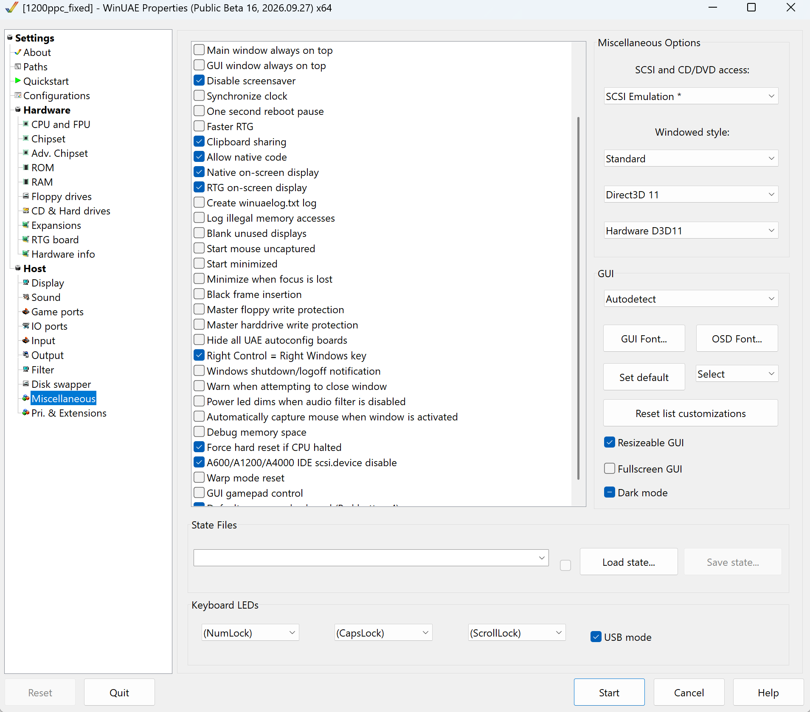

# QuarkTex NG

**Hardware-accelerated 3D for AmigaOS in WinUAE.** Warp3D, StormMESA (agl),
MiniGL, OpenGL ES 2.0 (ogles2) and OpenGL ES 3.0/3.1 (ogles3) programs
running in the emulated Amiga draw with the PC's graphics card through
OpenGL, instead of the emulated CPU drawing every pixel in software.

QuarkTex NG is an independent continuation of
[QuarkTex](https://github.com/RobDangerous/QuarkTex), the 3D virtualization
solution Robert Konrad released in 2003 (last version 0.53). It keeps its
license, the GNU LGPL v3, and its idea, and rebuilds the rest: a 64-bit
capable host library, a command buffer instead of one emulator call per
OpenGL function, a modern OpenGL renderer for Warp3D, a new
minigl.library, ogles2.library and ogles3.library, and frames written into
Amiga display memory so they show in fullscreen too.

Current release: **1.1**.

## What's new in 1.1

- **ogles3.library (new)**: OpenGL ES 3.0 and 3.1, the API of the PiStorm
  ogles3.library and its SDK (release 1.0) by **R-Typer and Ladislawv**
  ([github.com/ladislawv/ogles3](https://github.com/ladislawv/ogles3)), on
  the host's OpenGL 4.3. All 380 entries of its dispatch table are there:
  GLSL ES 3.00 and 3.10 shaders, vertex array objects, uniform buffers,
  instancing, transform feedback, queries, samplers, 3D and array
  textures, multiple render targets, multisampled renderbuffers, and
  OpenGL ES 3.1's compute shaders, storage buffers, atomic counters,
  images, indirect draws and dispatches, separate shader programs and
  multisample textures. The SDK's demos (Boing 2026, Boing Ocean, Boing
  Swarm with 16384 GPU-simulated lights, the ray traced Juggler) run
  unchanged, in a window and fullscreen. As the PiStorm library, a
  context is OpenGL ES 3.1 unless it asks for 2.0, and `GL_VERSION` reads
  "OpenGL ES 3.1 ogles3.library 1.0".
- **ogles2.library**:
  - Drawing from vertex buffers is much faster: the host keeps each
    buffer's converted copy and converts only what a draw reads and what
    changed (Quake III `timedemo four` 98 fps against 83 with 1.0 beta 3,
    same PC; OpenMoHAA's static models no longer slow it down).
  - Every entry of the SDK's table is implemented: ETC1 (and in ogles3
    ETC2/EAC) compressed textures, `GL_KHR_debug`, `glMultiDraw*EXT`, the
    base vertex draws, `glClipControlEXT` (with an OpenGL 4.5 driver).
  - `OGLES2_CCT_SHARE_WITH`: contexts share textures, buffers, shaders,
    programs and renderbuffers.
  - Contexts on the program's bitmap (`OGLES2_CCT_BITMAP`, `aglSetBitmap`)
    and resizing with `aglSetParams2` work and are tested; a bitmap has
    the frame when `aglSwapBuffers` returns.
  - The dispatch table's calls go to the context they are given, so a
    second task can draw with its own context, as the SDK describes.
  - Framebuffer 0 is the context's own picture: programs that bind it
    back after drawing into a texture show their frames.
  - `GL_VERSION` names the library ("OpenGL ES 2.0 ogles2.library 1.3").
- **minigl.library 30.0**: MiniGL's 30 SDK (PiStorm3D 30.0), which keeps
  the 29 SDK's interface; programs built with either run.
- **agl.library**: contexts on a rastport (`AMA_RastPort`, `AMA_Screen`)
  as StormMESA allowed, besides `AMA_Window`.
- **Windows in front of a 3D window stay as they are**: frames are
  written only into the visible parts of a window (all four APIs).
- **QuarkTexNGCheck.exe**: a small Windows program that says whether the
  PC's graphics driver can run QuarkTex NG, and why not.
- The host uses OpenGL 4.3 core contexts (3.3 when the driver has no 4.3:
  everything but OpenGL ES 3.1 still runs).
- Install the libraries and DLLs of this release together.

## What was new in 1.0 beta 3

- **ogles2.library**: the OpenGL ES 2.0 API of the PiStorm ogles2 SDK
  (1.3) by R-Typer and Ladislawv, with GLSL ES shaders, on the host's
  OpenGL 3.3. Programs built
  against that SDK run unchanged: its examples, and the PiStorm port of
  Quake III Arena with ioquake3's shader renderer (79 fps windowed and 84
  fps fullscreen in `timedemo four` at 640 × 480). Shaders are compiled
  from source; compressed textures and shader binaries are not supported.
- **Several programs at once**: every library keeps its state per program,
  so two or more 3D programs can draw at the same time, each in its own
  window ([docs/multitasking.md](docs/multitasking.md)).
- **Fullscreen in the right screen mode**: minigl.library and Warp3D's
  `W3D_BestModeID` asked Picasso96 for 24-bit modes, which WinUAE's RTG
  board does not have (its true colour modes are 32-bit). An 800 × 600
  screen then got a 640 × 480 mode, and WinUAE showed only its top left
  (Open Golf, RTCW). They now get the mode of their size.
- Warp3D: `W3D_GetScreenmodeList` ends its list properly (it ended in an
  uninitialised entry), `W3D_BestModeID` leaves the caller's tags as they
  are, `W3D_RequestMode` offers 32-bit modes for 24-bit formats.
- minigl.library no longer stops every game start with a requester about
  the FPU's precision; the warning stays in `QuarkTexNGLog.txt`.
- The protocol between libraries and DLLs changed: install the libraries
  and DLLs of this release together.

## What's new compared to QuarkTex 0.53

| | QuarkTex 0.53 (2003) | QuarkTex NG 1.1 |
| --- | --- | --- |
| WinUAE | 32-bit only (old uaelib traps) | 32-bit and **64-bit** (native code interface) |
| Host communication | one emulator call per OpenGL function | commands batched in a buffer |
| Warp3D | drawn from the 68k, vertex by vertex, OpenGL 1.1 | drawn on the host, batched, OpenGL core profile |
| APIs | Warp3D, StormMESA | Warp3D, StormMESA, **MiniGL**, **OpenGL ES 2.0** and **OpenGL ES 3.0/3.1** (new minigl.library, ogles2.library and ogles3.library) |
| Display | a host window over the emulator: windowed mode only | frames written into Amiga RTG memory: window, full window and **fullscreen**, with WinUAE's scaling, filters and recording |
| Stencil buffer, chroma key, mipmaps | missing | supported |
| Several 3D contexts at once | no | yes, also in several programs at the same time |
| Fog | drawn black | correct |
| Paletted textures, texture colours, texture updates | wrong | correct |
| Z-buffer reads and writes | garbage | correct |
| W3D_Query | "fully supported" for nearly everything | what the renderer really does |
| Memory leaks | textures leaked on context close | freed |
| Build and tests | StormC 4, Visual Studio 2008, no tests | GCC and CMake in Docker; automated pixel-by-pixel tests against 0.53, unit tests |

## Performance

Test system: Intel Iris Xe graphics, WinUAE 6.0.3 and 6.x betas, AmigaOS
3.2, 68040/68060 at `cpu_speed=max`.

### Warp3D: 1.2 million triangles (test t09_throughput)

| Version | JIT off | JIT on |
| --- | --- | --- |
| QuarkTex 0.53, 32-bit WinUAE | 3.23 s | 1.34 s |
| QuarkTex NG, 32-bit WinUAE | 1.92 s (40 % less) | **0.39 s (3.4× faster)** |
| QuarkTex NG, 64-bit WinUAE | 1.83 s (44 % less) | **0.44 s (3.1× faster)** |

Time the host spends drawing 60,000 triangles:

| Renderer | Host time | Triangles per second |
| --- | --- | --- |
| OpenGL 1.1, one call per vertex attribute | 27-29 ms | 2.6-2.8 million |
| OpenGL 3.3 core, batched | **10 ms** | **5.9-6.3 million** |

### MiniGL: Return to Castle Wolfenstein

640 × 480, the game's frame cap off (`com_maxfps 0`), level escape1.
QuarkTex 0.53 had no MiniGL, so the reference is MiniGL Classic on Warp3D.

| Path | fps |
| --- | --- |
| MiniGL Classic + Warp3D | 157 |
| QuarkTex NG minigl.library, first version (vertex arrays on the 68k) | 111 |
| QuarkTex NG minigl.library, vertex arrays on the host | 188 (windowed only) |
| QuarkTex NG minigl.library, fullscreen-capable, asynchronous presenting | **~170** (window, full window and fullscreen) |

| Per frame | Before | Now |
| --- | --- | --- |
| Commands from the 68k to the host | 1.37 MB | **22 KB** |
| Showing the frame in Amiga display memory | 2.7 ms | **0.33 ms** |

At these rates RTCW is limited by the emulated 68k; a faster PC CPU goes
higher. Capped at its usual 60 fps the game runs at its cap. Jedi Knight II
runs at its own 90 fps cap.

### Games tested

| Game | API | Result |
| --- | --- | --- |
| Return to Castle Wolfenstein | MiniGL | menus and levels, multitexture lightmaps |
| Star Wars Jedi Knight II | MiniGL | intro, cutscenes with lip sync, levels |
| OpenLara (Tomb Raider) | MiniGL | intro videos, menu, levels |
| Hurrican | MiniGL | cracktro, menu, levels |
| Open Golf | MiniGL | menu and game, in a window and fullscreen |
| Quake III Arena (PiStorm GLES2 port) | ogles2 | menu, game and `timedemo four`, in a window and fullscreen |
| ogles2 SDK examples (triangle, cube, boingocean, boing2026) | ogles2 | render-to-texture, shadow maps, MSAA framebuffers |
| OpenMoHAA | ogles2 | levels with lightmaps |
| ogles3 1.0 demos (Boing 2026, Boing Ocean, Boing Swarm, Juggler RT) | ogles3 | OpenGL ES 3.1 compute, HDR, ray tracing; window and fullscreen |

### OpenGL ES 2.0: Quake III Arena

The PiStorm port of Quake III Arena with ioquake3's GLES2 renderer
(`Quake3-GLES2`), `timedemo four` at 640 × 480:

| Path | fps |
| --- | --- |
| A1200 with PiStorm and a Raspberry Pi 4 (the port's own figure) | 80.4 |
| QuarkTex NG ogles2.library, WinUAE window | **79.0** |
| QuarkTex NG ogles2.library, fullscreen | **83.6** |

`quake3-gl2 +set sys_nostdout 0 +set nextdemo quit +timedemo 1 +demo four`
prints the result in the Shell.

## Requirements

- Windows with a graphics card and driver for OpenGL 4.3 (with 3.3 only,
  everything but OpenGL ES 3.1 runs; `QuarkTexNGCheck.exe` tells).
- WinUAE (tested with 6.0.3 and the 6.x public betas), 32-bit or 64-bit.
- AmigaOS 3.x with an RTG board (uaegfx) and Picasso96, a 68020 or better
  with FPU (68040/68060 recommended).

## Installation

0. Run `QuarkTexNGCheck.exe` (in the archive, or built with the host
   library) on the PC: it shows the graphics card, its driver, OpenGL and
   GLSL versions and the highest OpenGL core profile it creates, and ends
   with `QuarkTex NG support = PASS` if the driver can run QuarkTex NG (an
   OpenGL 4.3 core profile), `FAIL` with the reason if not. Double-clicked
   it opens a window (with a button that copies the report, for a bug
   report); in a command prompt it prints the report and returns 0 for
   PASS, 1 for FAIL (`/gui` opens the window there too).
1. Copy `quarktexng-windows-x86.dll` and `quarktexng-windows-x86-64.dll` into
   the WinUAE directory (or its `plugins` directory). Older
   `quarktex-windows-*.dll` files are not used any more.
2. Copy `Warp3D.library`, `agl.library` (StormMESA), `minigl.library`
   (MiniGL), `ogles2.library` (OpenGL ES 2.0) and `ogles3.library` (OpenGL
   ES 3.0/3.1) to `LIBS:` in AmigaOS. The libraries and the DLLs belong
   together: a library of one release does not work with a DLL of another.
3. Set up WinUAE as below.

## WinUAE settings

Two settings are **required**; the others are what QuarkTex NG was tested
and measured with. Each is given as it appears in WinUAE's settings window
and as the line in a `.uae` configuration file.

### 1. Allow native code (required)

**Settings → Host → Miscellaneous → Allow native code**
(`native_code=true`). The Amiga libraries reach the host DLL through
WinUAE's native code interface; without it Warp3D, StormMESA and MiniGL
programs find no driver.



### 2. CPU, FPU and JIT (Settings → Hardware → CPU and FPU)

| Setting | Value | Configuration file | |
| --- | --- | --- | --- |
| CPU | 68040 or 68060 | `cpu_type=68060`, `cpu_model=68060` | recommended |
| CPU speed | **Fastest possible** | `cpu_speed=max` | recommended |
| FPU | **CPU internal** (the 68040's or 68060's own FPU) | `fpu_model=68060` | required: the libraries are built for a 68020-68060 with FPU |
| FPU precision | **Host (80-bit)** | `fpu_msvc_long_double=true` | **required** |
| JIT | **on** | | strongly recommended |
| JIT cache size | **16 MB** (slider at its maximum) | `cachesize=16384` | strongly recommended |
| JIT FPU support | **on** | `compfpu=true` | strongly recommended |
| More compatible | off | `cpu_compatible=false`, `fpu_strict=false` | |

Why these matter:

- **FPU precision: Host (80-bit).** A real 68881, 68040 or 68060 FPU
  computes with 80-bit extended precision. WinUAE's default, *Host
  (64-bit)*, uses 64-bit doubles, and the games then compute values a real
  Amiga does not: in Jedi Knight II the first person weapon never appears,
  in Return to Castle Wolfenstein it disappears during play (their matrices
  become NaN). With *Host (80-bit)* both show. QuarkTex NG checks the
  precision when a library opens and writes a warning into
  `QuarkTexNGLog.txt`. *Softfloat
  (80-bit)* is precise too, but WinUAE cannot combine it with the JIT's FPU
  support, so it is much slower.
- **JIT and JIT FPU support.** The 3D work runs on the PC, but the game
  itself still runs on the emulated 68k; that is where the frame time goes
  (RTCW: about 4.8 ms of a 5.9 ms frame). With the JIT's FPU support turned
  off, Jedi Knight II fell from its 90 fps cap to about 15 fps. *Host
  (80-bit)* keeps working with the JIT FPU on.
- **JIT cache size.** Large games such as RTCW and Jedi Knight II run a lot
  of 68k code; the largest cache (16 MB) keeps it translated.

### 3. RTG board, display and memory

| Setting | Where in WinUAE | Configuration file | |
| --- | --- | --- | --- |
| RTG board | Hardware → RTG board: UAE Zorro III, 64 MB or more | `gfxcard_type=ZorroIII`, `gfxcard_size=64` | required for fullscreen |
| Display | Host → Display: window, full window or fullscreen | `gfx_fullscreen_picasso=true` or `fullwindow` | all three work |
| Z3 Fast RAM | Hardware → RAM: 256 MB or more for large games | `z3mem_size=512` | recommended |
| Sound | Host → Sound enabled; AHI with WinUAE's `uae.audio` driver | `sound_output=exact` | for the games' sound and lip sync |

QuarkTex NG writes each frame into the Amiga's RTG display memory, in the
screen's own format (15-, 16-, 24- and 32-bit modes), so WinUAE shows it like
any other Amiga graphics, scaled and filtered with the rest of the display.
Fullscreen screens get the display mode of their size from Picasso96, so a
game's 1024 × 768 screen opens in a 1024 × 768 mode. On planar or 8-bit
(CLUT) screens QuarkTex NG falls back to drawing in a host window, which
shows only while WinUAE runs in a window.

## Known issues

- MiniGL Classic (the Warp3D-based minigl.library) in fullscreen crashes on
  QuarkTex NG's Warp3D. QuarkTex NG's own minigl.library runs the same games.
- The rotating passport in OpenLara's menu draws dark.
- ogles2.library and ogles3.library: no shader or program binary formats
  are offered; `glClipControlEXT` needs a host driver with OpenGL 4.5;
  `OGLES2_CCT_VSYNC` and multisampling of the default framebuffer are
  ignored.
- A window in front of a 3D window is kept as it is, but a smart refresh
  window's hidden parts are not updated while they are covered.
- Breaking Quake III (ogles2) with Ctrl-C during play reset the Amiga; a
  normal quit does not.

## Building

Everything builds in Docker; Docker and a POSIX shell (Git Bash on Windows)
are all that is needed:

```sh
./build.sh            # everything, collected in dist/
./build.sh amiga      # Warp3D.library, agl.library; minigl.library, ogles2.library and ogles3.library with MINIGL_SDK, OGLES2_SDK and OGLES3_SDK
./build.sh host       # quarktexng-windows-x86.dll and -x86-64.dll (MinGW-w64)
./build.sh tests      # test programs, see tests/README.md
./build.sh unittest   # the OpenGL command buffer encoder/decoder on the build host
./build.sh generate   # regenerate gl/*.auto.* after editing gl/glFuncs.txt
```

`minigl.library` needs MiniGL's SDK headers, which are not part of this
repository (they are under the Hyperion MiniGL Open Source License):
`MINIGL_SDK=<sdk>/dev/include ./build.sh amiga`. `ogles2.library` needs the
ogles2 SDK (github.com/ladislawv/ogles2, its headers are MIT):
`OGLES2_SDK=<ogles2-sdk>/ogles2/SDK ./build.sh amiga`, and
`ogles3.library` the ogles3 SDK (github.com/ladislawv/ogles3, release 1.0):
`OGLES3_SDK=<ogles3-sdk-1.0> ./build.sh amiga`.

The host DLLs also build with Visual Studio 2022:
`cmake -S . -B build/host-x64 -A x64` and `cmake --build build/host-x64 --config Release`
(`-A Win32` for the 32-bit DLL).

The product name and version are set in one place, `PRODUCT` in
`amiga/Makefile`.

## Tests

`tests/run.ps1` runs reference programs (Warp3D and StormMESA) in a
portable copy of WinUAE, once with QuarkTex 0.53 and once with the current
build, and compares the frames pixel by pixel; differences that are fixes
are listed in `tests/known-differences.txt`. Each test also reports what the
Amiga display shows. `tests/run-app.ps1` runs any Amiga program in that
WinUAE, with frame capture, profiling (`-Profile`), command tracing
(`-TraceFrame`), fullscreen modes and extra WinUAE options. See
[tests/README.md](tests/README.md).

## Repository layout

| Directory | Contents |
| --- | --- |
| `Warp3D.library/` | Warp3D 4 API on the host renderer (68k) |
| `agl.library/` | StormMESA API on OpenGL (68k) |
| `minigl.library/` | MiniGL's shared library interface on OpenGL (68k) |
| `ogles2.library/` | the ogles2 SDK's OpenGL ES 2.0 interface on the host's OpenGL (68k) |
| `ogles3.library/` | OpenGL ES 3.0/3.1 of the ogles3 SDK, built with ogles2.library's sources (68k) |
| `gl/` | 68k bridge to the host, partly generated from `glFuncs.txt` |
| `amiga/` | library skeleton and build files for the 68k side |
| `host/` | host DLL: OpenGL contexts, Warp3D renderer, presenting into Amiga memory |
| `tests/` | reference tests, self-checking tests, WinUAE scripts |
| `docs/` | design notes for each phase of the work |

## License and credits

- **QuarkTex** © 2003–2012 Robert Konrad, released under the GNU Lesser
  General Public License version 3.
- **QuarkTex NG**, changes and additions since 2026 © Serkan DURSUN,
  released under the same license. QuarkTex NG is a modified version of
  QuarkTex; its changes are recorded in the git history and in `docs/`. It
  is not made or endorsed by the original author.
- **ogles2.library** implements the interface of the PiStorm ogles2.library
  and its SDK by **R-Typer and Ladislawv**
  ([github.com/ladislawv/ogles2](https://github.com/ladislawv/ogles2)); it
  is built against their SDK's headers and tested with their examples.
- **ogles3.library** implements the interface of the PiStorm ogles3.library
  (OpenGL ES 3.1) and its SDK, also by **R-Typer and Ladislawv**
  ([github.com/ladislawv/ogles3](https://github.com/ladislawv/ogles3)); it
  is built against that SDK's headers and tested with its demos.

The license texts: [License.txt](License.txt) (GNU LGPL v3) and
[COPYING](COPYING) (GNU GPL v3, on which the LGPL v3 builds).

[ThirdParty.txt](ThirdParty.txt) collects the notices of everything made by
others that is in the release or that it is built with, among them the
mingw-w64 runtime that the host DLLs contain (Zope Public License 2.1).

Third-party files in this repository keep their own terms:

- `Warp3D.library/Warp3D.h`, `Warp3D.library/Warp3D.fd`: Warp3D API
  include files, © 1998 Sam Jordan, Hans-Jörg Frieden, Thomas Frieden,
  used unchanged for compatibility with the Warp3D API. They are not under
  the LGPL and are left out of the source in the Aminet archive, which
  says where to get them (this repository, or QuarkTex's original one).
- `agl.library/Amigamesa.h`: from Mesa 1.2, © 1995 Brian Paul, GNU Library
  General Public License version 2 or later.

MiniGL's SDK is not included; building `minigl.library` reads its headers,
which are © Hyperion under the Hyperion MiniGL Open Source License.
